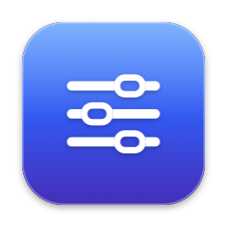

<p align="center"></p>

# LogiBar

A tiny macOS menu bar app for controlling Logitech lights, webcams and mice: a lightweight alternative to Logi Tune.

There are no accounts, background helpers, updaters or web views. It's one small native app (~1 MB) that talks to your devices directly over USB and Bluetooth.

> LogiBar is an independent project and is not affiliated with or endorsed by Logitech. "Logitech", "Litra", "MX Master" and related names are trademarks of Logitech.

## Features

| Device | Controls |
|---|---|
| **Litra Glow / Beam / Beam LX** | On/off, brightness, color temperature (2700–6500 K), and an option to **turn the light on automatically whenever any camera is in use** (Zoom, Meet, FaceTime…), then off again afterwards |
| **Logitech UVC webcams** (C920, C922, Brio, StreamCam…) | Zoom, focus and auto focus, white balance and auto white balance, brightness. Under **More**: exposure and auto exposure, contrast, saturation, sharpness, gain, backlight compensation, reset to defaults. Settings are saved per camera and re-applied when it's plugged back in. |
| **MX Master and other HID++ 2.0 mice over Bluetooth** | Battery level and charging state, pointer speed (DPI), SmartShift ratchet/free-spin and sensitivity |

Plus: **Launch at login**, and devices appear and disappear automatically as you plug them in.

### Tested hardware

- Litra Glow (USB)
- HD Pro Webcam C920
- MX Master 4 over Bluetooth

Other models using the same protocols should work. Mice connected through a Logi Bolt or Unifying USB receiver are **not** supported yet: only direct Bluetooth.

## Requirements

- macOS 14 Sonoma or later (developed on macOS 27), Apple silicon
- Xcode **or** just the Command Line Tools (`xcode-select --install`)

## Build and install

```bash
git clone https://github.com/TomAC81/LogiBar.git
cd LogiBar
./build.sh --install     # builds, copies to /Applications, and launches
```

`./build.sh` without `--install` only builds; it prints where the bundle is.

The bundle is assembled in a temporary folder (not inside the repo), because cloud-synced folders add extended attributes that break code signing.

### Code signing (recommended)

The mouse needs the **Input Monitoring** permission, and macOS ties that permission to the app's signature. With the default ad-hoc signature, every rebuild counts as a new app and you'd have to grant it again.

To avoid that, create a local self-signed code-signing certificate named exactly **`LogiBar Local Signing`** once. `build.sh` uses it automatically when it exists:

```bash
cat > /tmp/logibar-cert.cnf <<'CNF'
[req]
distinguished_name=dn
x509_extensions=ext
prompt=no
[dn]
CN=LogiBar Local Signing
[ext]
basicConstraints=critical,CA:false
keyUsage=critical,digitalSignature
extendedKeyUsage=critical,codeSigning
CNF
openssl req -x509 -newkey rsa:2048 -nodes -days 3650 -config /tmp/logibar-cert.cnf -keyout /tmp/k.pem -out /tmp/c.pem
openssl pkcs12 -export -legacy -inkey /tmp/k.pem -in /tmp/c.pem -out /tmp/c.p12 -passout pass:tmp
security import /tmp/c.p12 -k ~/Library/Keychains/login.keychain-db -P tmp -T /usr/bin/codesign
rm /tmp/k.pem /tmp/c.pem /tmp/c.p12 /tmp/logibar-cert.cnf
```

This certificate only signs your own local build. It isn't trusted system-wide and grants nothing else. You can delete it from Keychain Access at any time.

## First run and permissions

1. Click the slider icon in the menu bar.
2. The light and camera work immediately; they need no permissions.
3. For the mouse, macOS asks for **Input Monitoring**. Allow it, or enable LogiBar in **System Settings → Privacy & Security → Input Monitoring**, then quit and reopen LogiBar.

If the permission seems stuck (the mouse card says it needs permission even though LogiBar is switched on), reset it and reopen the app:

```bash
pkill -x LogiBar; tccutil reset ListenEvent com.local.logibar; open /Applications/LogiBar.app
```

## Privacy and security

- **No network access.** LogiBar contains no networking code and never connects to the internet. There's no telemetry or analytics, and nothing to update.
- **No other processes.** It doesn't run shell commands, scripts or helper tools.
- **Input Monitoring is used only to talk to the mouse.** macOS requires this permission to send configuration commands to a pointing device. LogiBar looks only at the mouse's configuration replies (HID++ reports, ID `0x11`). Pointer movement and clicks are discarded immediately and never stored or logged. It never reads the keyboard.
- **It never opens the camera.** Webcam settings are changed with standard USB Video Class *control* requests, which don't start the video stream or access any image. Camera-in-use detection reads the system-wide "device is running somewhere" flag from CoreMediaIO, which doesn't require camera permission.
- **Local data only:**
  - `~/Library/Logs/LogiBar.log`: diagnostic log of device discovery and settings commands (rotated at 512 KB). It contains no personal data.
  - LogiBar's preferences (`com.local.logibar`) store saved camera settings and the "light with camera" option.
- **Unsandboxed.** Direct USB/HID access isn't possible from the App Sandbox, so LogiBar runs unsandboxed like most hardware utilities. The source is small enough (~1,000 lines) to read in full.

## How it works

See [docs/PROTOCOLS.md](docs/PROTOCOLS.md) for the device protocols. In short:

| Part | File | Mechanism |
|---|---|---|
| Light | `Sources/Litra.swift` | HID output reports (`0x11 ff 04 …`) via IOHIDDevice |
| Mouse | `Sources/Mouse.swift` | Logitech HID++ 2.0 over Bluetooth LE (features `0x1004`, `0x2201`/`0x2202`, `0x2111`/`0x2110`) |
| Webcam | `Sources/uvc.c`, `Sources/Camera.swift` | UVC class control requests on the VideoControl interface via IOUSBLib |
| Camera-in-use | `Sources/CameraWatch.swift` | CoreMediaIO `kCMIODevicePropertyDeviceIsRunningSomewhere`, polled every second |
| Device discovery | `Sources/Hub.swift` | IOHIDManager hot-plug callbacks; USB registry scan for webcams every 3 s |
| HID transport | `Sources/HID.swift` | Request/response over a dedicated run-loop thread plus a serial I/O queue |
| UI | `Sources/App.swift` | SwiftUI `MenuBarExtra` (window style) |
| Icon | `Tools/make-icon.swift` | Renders `Resources/AppIcon.icns` |

To regenerate the icon:

```bash
swiftc Tools/make-icon.swift -o /tmp/make-icon && /tmp/make-icon /tmp && iconutil -c icns /tmp/AppIcon.iconset -o Resources/AppIcon.icns
```

## Troubleshooting

| Symptom | Fix |
|---|---|
| Mouse card says it needs Input Monitoring | See *First run and permissions* above. |
| Mouse card says "Not responding" | Make sure the mouse is connected over Bluetooth, not a USB receiver. |
| Camera missing | It must be a Logitech UVC camera connected over USB. Check the log. |
| Settings fighting with Logi Tune / Logi Options+ | Quit those apps; they also write device settings. |
| Anything else | `tail -50 ~/Library/Logs/LogiBar.log` |

## Uninstall

```bash
pkill -x LogiBar; rm -rf /Applications/LogiBar.app
defaults delete com.local.logibar; rm -f ~/Library/Logs/LogiBar*.log
tccutil reset ListenEvent com.local.logibar
```

Also untick **Launch at login** first, or remove LogiBar from **System Settings → General → Login Items**.

## License

[MIT](LICENSE)
